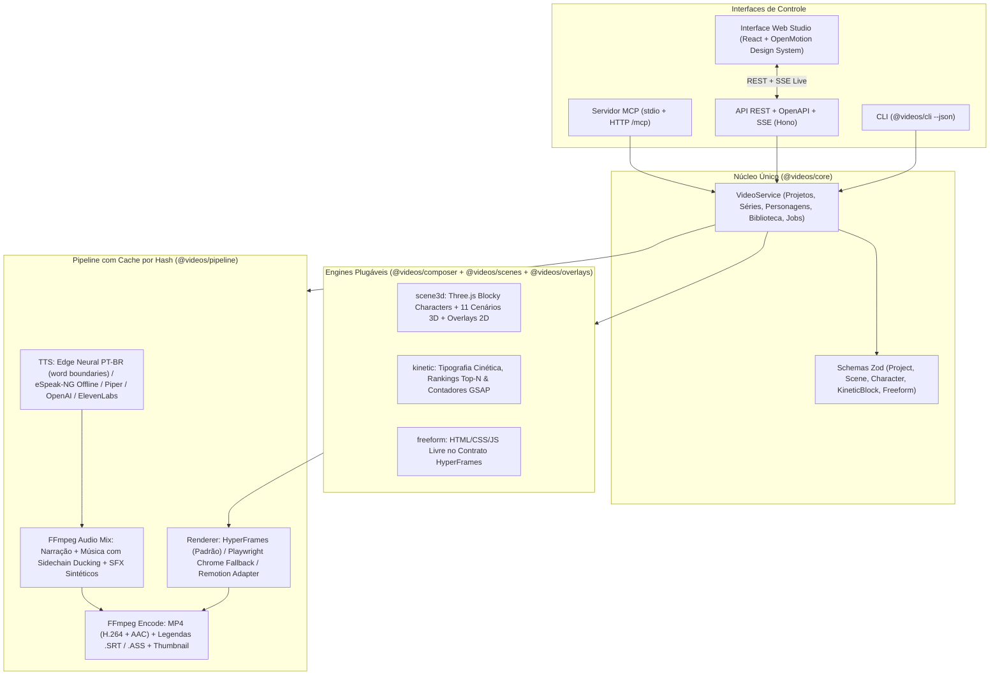

# Videos Studio — Pipeline, Interface Web & Servidor MCP para Vídeos Curtos Verticais (Reels / Shorts)

Gerador open source de vídeos curtos verticais (9:16, 720×1280 e 1080×1920) com renderização determinística via **Three.js**, **GSAP**, **HyperFrames** e **FFmpeg**.

O formato principal (**`scene3d`**) recria o estilo visual da série **"SIMULAÇÃO 2030"**: personagens 3D procedurais *blocky/chibi* consistentes (zero custo de geração por frame), 11 cenários 3D low-poly parametrizáveis, movimentos de câmera suaves, overlays jornalísticos 2D e legendas centrais palavra a palavra com destaque amarelo (`#f5c518`). A arquitetura também suporta engines plugáveis para **Tipografia Cinética (`kinetic`)** e **Composição Livre HTML/CSS/GSAP (`freeform`)**, além de uma **Biblioteca local com +3.200 itens** (prompts virais, 99 estilos de filme, 244 efeitos PixelFX, ~450 blocos HyperFrames e modo "Recriar a partir de vídeo" baseado no Rea-Video).

---

## Arquitetura

Toda a lógica de negócio e persistência reside em uma **camada de serviço única** (`VideoService` em `packages/core`). A Interface Web, o Servidor MCP (stdio e Streamable HTTP), a CLI e a API REST chamam exclusivamente essa camada, com sincronização ao vivo via Server-Sent Events (SSE).



### Estrutura do Monorepo (npm workspaces + TypeScript)

| Pacote / App | Descrição |
| --- | --- |
| `packages/core` | Schemas Zod (`Series`, `Project`, `Scene`, `Character`, `VoiceConfig`, `CaptionStyle`, `RenderSettings`, `KineticBlock`, `FreeformComposition`, `LibraryItem`, `ReferenceBreakdown`) e camada única `VideoService`. |
| `packages/scenes` | Gerador procedural Three.js de personagens *blocky/chibi* parametrizáveis (10 poses procedurais), 11 templates de cenário 3D e 6 presets de câmera. |
| `packages/overlays` | Overlays 2D (`title`, `badge`, `lower-third`, `role-banner`, `counter`, `watermark`, `progress-bar`, `effect`), legendas word-by-word (`highlight-yellow`, `karaoke`, `pop`, `box`), fontes locais `@fontsource` (`Anton`, `Bebas Neue`, `Inter`) e geradores `.srt`/`.ass`. |
| `packages/composer` | Abstração `VideoEngine` (`scene3d`, `kinetic`, `freeform`) que transforma o projeto + áudio + timestamps em uma composição HTML determinística no contrato do HyperFrames (`window.__timelines["main"]` e `window.__seek(t)`). |
| `packages/pipeline` | Estágios com cache por hash SHA-256 (`tts`, `audio-mix`, `compose`, `render`, `encode`), sincronizador da Biblioteca (`library:sync`) e analisador de vídeo de referência (`Rea-Video` + `ffmpeg` scene detection). |
| `apps/server` | Servidor Hono com API REST, especificação OpenAPI 3.1 (`/api/openapi.json`), fila de jobs com progresso via SSE (`/api/events`), arquivos estáticos e **MCP Streamable HTTP** em `/mcp`. |
| `apps/mcp` | Servidor MCP via `stdio` (29 tools, 3 resources e 2 prompts). |
| `apps/cli` | CLI completa com suporte a `--json`, gerador de exemplos (`npm run gen`) e sincronizador da biblioteca (`npm run library:sync`). |
| `apps/web` | Interface Web Studio construída com os tokens, fontes, ícones e padrões visuais do OpenMotion Design System. |

---

## Setup e Execução Rápida

### Pré-requisitos
- Node.js >= 22 (testado em Node 24)
- `ffmpeg` e `ffprobe` no `PATH`
- `/usr/bin/google-chrome`
- `espeak-ng` (com voz `pt-br` para fallback offline)

### Instalação

```bash
npm install
cp .env.example .env
```

Variáveis de ambiente: `VIDEOS_DATA_DIR` define o diretório de dados (personagens, séries, jobs, projetos); padrão `./data`.

### Sincronizar a Biblioteca Local (+3.200 prompts, estilos, efeitos e blocos)

```bash
npm run library:sync
```

Clona com `--depth 1` os repositórios de referência em `library/vendor/` (diretório ignorado pelo Git) e indexa os ~450 blocos locais do HyperFrames em `library/index.json`.

### Gerar os 3 Exemplos de Ponta a Ponta (MP4 + SRT + ASS)

```bash
# 1. Exemplo obrigatório Flagship (Simulação 3D — 7 cenários 3D, personagem Marco Silva)
npm run gen -- --example simulacao-demo

# 2. Exemplo Tipografia Cinética (Top 5 Tech 2030)
npm run gen -- --example kinetic-top5

# 3. Exemplo Freeform HTML/CSS/GSAP
npm run gen -- --example freeform-demo
```

Os vídeos finais são salvos em:
- `renders/simulacao-demo.mp4` (+ `.srt`, `.ass`, `-thumb.png`)
- `renders/kinetic-top5.mp4`
- `renders/freeform-demo.mp4`

### Iniciar o Servidor + Interface Web Studio

```bash
# Compila o frontend e inicia o servidor completo (UI + REST + SSE + MCP HTTP) em http://127.0.0.1:3456
npm run build:web
npm run server

# Ou em modo de desenvolvimento Vite (http://127.0.0.1:5173 com proxy para :3456):
npm run dev:web
```

---

## Conectando uma IA Externa via MCP (Caminho Principal)

O projeto foi desenhado para que um agente externo (Claude Code, Cursor, Gemini CLI, etc.) crie o episódio completo sem exigir chave de LLM configurada no app. Todas as alterações feitas pelo agente atualizam a Interface Web ao vivo via SSE.

### 1. Claude Code CLI (`claude mcp add`)

```bash
claude mcp add videos-studio -- npx tsx /home/higorlino/.t3/projects/videos/apps/mcp/src/index.ts
```

### 2. Arquivo `.mcp.json` (Claude Desktop / Cursor / VS Code)

```json
{
  "mcpServers": {
    "videos-studio": {
      "command": "node",
      "args": [
        "--import",
        "tsx",
        "/home/higorlino/.t3/projects/videos/apps/mcp/src/index.ts"
      ],
      "cwd": "/home/higorlino/.t3/projects/videos"
    }
  }
}
```

### 3. Gemini CLI (`~/.gemini/settings.json`)

```json
{
  "mcpServers": {
    "videos-studio": {
      "command": "node",
      "args": [
        "--import",
        "tsx",
        "/home/higorlino/.t3/projects/videos/apps/mcp/src/index.ts"
      ]
    }
  }
}
```

### 4. MCP Streamable HTTP

Quando `npm run server` está ativo, o endpoint MCP Streamable HTTP responde diretamente em:
- **URL**: `http://127.0.0.1:3456/mcp`

### Tools MCP Disponíveis (34 tools)

- **Engines & Templates**: `list_engines`, `get_engine_schema`, `list_templates`
- **Design Kits (Brand / Identidade Visual Multi-Engine)**: `list_design_kits`, `get_design_kit`, `create_design_kit`, `update_design_kit`, `apply_design_kit`
- **Biblioteca & Engenharia Reversa**: `search_library`, `get_library_item`, `breakdown_reference_video`
- **Personagens & Vozes**: `list_characters`, `create_character`, `update_character`, `list_voices`
- **Séries & Projetos**: `list_series`, `create_series`, `create_project`, `get_project`, `validate_project` (inclui checagem de conformidade com o Design Kit: paleta, fontes e safe areas 9:16)
- **Roteiro, Cenas, Overrides 2D/3D & Estilos**: `set_script`, `set_composition`, `apply_style`, `add_effect`, `add_scene`, `update_scene` (suporta `overlays` com geometria 2D `x/y/width/height/rotation` e `objectOverrides` 3D + `cameraOverride`), `remove_scene`, `reorder_scenes`
- **Áudio, Imagens, Preview Visual & Render**: `synthesize_audio`, `generate_image`, `render_preview_frames` (retorna PNGs como imagens MCP para inspeção visual do agente), `render_video`, `get_job_status`, `get_output`

### Resources & Prompts MCP
- **Resources**: `videos://docs/scene-schema`, `videos://docs/style-guide`, `videos://templates/{id}`
- **Prompts**: `create_episode` (fluxo Simulação 3D) e `create_video` (fluxo genérico multi-engine)

---

## Interface Web Studio (10 Telas — Editor NLE & Design Kits OpenMotion)

1. **Dashboard**: Projetos e séries com preview de vídeo 9:16, status e download direto de MP4/SRT.
2. **Editor de Vídeo NLE + Canvas Visual 2D/3D (Estilo OpenMotion + Figma)**:
   - **Canvas Central 9:16**: Seleção e arraste de overlays 2D com snapping magnético a bordas/centros/safe areas 9:16, redimensionamento, rotação, edição de texto inline (duplo-clique), seleção por marquee, Raycast + Gizmo 3D (`TransformControls` XYZ de `three/examples/jsm`) para mover/rotacionar/escalar personagens e objetos 3D (`scene.objectOverrides`), órbita de câmera com **"Salvar Keyframe de Câmera"** (`scene.cameraOverride`) e modo avançado de **Código HTML/JSON sincronizado**.
   - **Timeline Multitrilha NLE**: 6 trilhas sincronizadas (`V1 Cenas 3D`, `V2 Overlays 2D`, `C1 Legendas`, `A1 Narração TTS com Waveform Canvas`, `A2 Música & SFX`), arrastar/aparar (trim)/dividir (`S`) clipes, zoom da timeline, scrubbing na régua e atalhos (`Espaço`, `J/K/L`, `S`, `Delete`, `Ctrl+Z`/`Ctrl+Shift+Z` Undo/Redo).
   - **Camadas & Inspector**: Reordenação Z-Order, visibilidade de camadas 2D e objetos 3D, alinhamento rápido e inspector completo de propriedades.
3. **Design Kits**: Gerenciador de identidades visuais multi-engine (`Simulação 2030`, `Editorial Minimal` e kits customizados) com paleta semântica, tipografia, safe areas 9:16, ritmo, regras livres, moodboard de referências com ficha `Rea-Video`, extração local de paleta de cores via FFmpeg/Canvas, importação/exportação JSON e preview ao vivo nos 3 engines.
4. **Biblioteca**: Grid de cards com busca instantânea e filtros (`prompt`, `style`, `effect`, `block`, `technique`) sobre os +3.200 itens indexados, com botão **"Usar este prompt/estilo"** que abre o Wizard já preenchido.
5. **Recriar Vídeo**: Upload ou caminho de vídeo MP4 de referência → detecção de cortes via FFmpeg + extração de frames + ficha Rea-Video → botão para criar projeto.
6. **Wizard**: Seleção de Formato (`scene3d`, `kinetic`, `freeform`), Estilo da Biblioteca, tema, duração (`30/60/90/150s`), tom, nº de cenas, voz/velocidade, estilo de legenda, personagem 3D, música e série.
7. **Editor de Personagem 3D**: Preview 3D **orbitável 360°** com mouse e zoom, teste das 10 poses procedurais, cores de pele/cabelo/barba/óculos/roupas, escala chibi da cabeça e acessórios (`sash`, `tie`, `suit`, `hat`, `microphone`, `badge`).
8. **HyperFrames Preview**: Scrubbing sincronizado com áudio master e captura de snapshots PNG pelo HyperFrames.
9. **Render & Galeria**: Resolução (`720x1280` ou `1080x1920`), FPS, CRF, workers, escolha de renderer (`hyperframes`, `playwright`, `remotion`), progresso SSE por estágio com logs ao vivo e download MP4/SRT/ASS.
10. **Configurações & 13 Integrações**: Edição de chaves `.env`, teste de vozes com preview de áudio e painel de status das 13 ferramentas do ecossistema.

---

## CLI (`@videos/cli`)

Todos os comandos aceitam `--json` para integração com scripts:

```bash
npm run cli -- list-engines --json
npm run cli -- list-templates --json
npm run cli -- search-library --query "chart" --type block --json
npm run cli -- validate-project --projectId simulacao-demo --json
npm run cli -- render-preview-frames --projectId simulacao-demo --json
npm run cli -- breakdown-reference-video --video /caminho/referencia.mp4 --json
```

---

## Criando um Novo Engine (`VideoEngine`)

Para adicionar um novo formato de vídeo (ex: `quiz`, `podcast-avatar`, `code-walkthrough`):

1. Adicione o identificador em `VideoEngineIdSchema` em `packages/core/src/schemas.ts` e descreva-o em `VIDEO_ENGINES` (`packages/core/src/catalog.ts`).
2. Implemente a interface `VideoEngine` em `packages/composer/src/index.ts`:
   ```ts
   export class MeuNovoVideoEngine implements VideoEngine {
     public readonly id = 'meu-engine' as const;
     public async compose(project, characters, outputDir, options): Promise<ComposedArtifact> {
       prepareCompositionAssets(outputDir, options?.workspaceRoot);
       // Gere index.html com <div id="root" data-composition-id="main" ...>
       // Registre window.__timelines["main"] = gsap.timeline({ paused: true })
       // Exponha window.__seek = (t) => ...
       return { engine: this.id, compositionDir: outputDir, indexHtmlPath, srtPath, assPath, totalDuration, allWordTimestamps };
     }
   }
   ```
3. Registre a instância no mapa `ENGINE_REGISTRY` em `packages/composer/src/index.ts`. Toda a pipeline de TTS, mixagem FFmpeg, preview de frames, HyperFrames render, MCP, CLI e UI passará a suportá-lo automaticamente.

---

## As 13 Ferramentas & Integrações do Ecossistema

Todas as integrações externas são opcionais, desligadas por padrão quando exigem servidor próprio e detectadas automaticamente em **Configurações → Integrações**:

1. **HyperFrames** (`heygen-com/hyperframes`) — Renderizador HTML → MP4 determinístico e ~450 blocos locais.
2. **Three.js** (`mrdoob/three.js`) — Motor 3D WebGL para personagens blocky e cenários procedurais.
3. **GSAP** (`greensock/GSAP`) — Timeline determinística pausada e seekável.
4. **FFmpeg** — Mixagem de áudio com sidechain ducking, SFX sintéticos, scene detection e encode H.264/AAC.
5. **Rea-Video** (`JuneYaooo/rea-video`) — Metodologia de breakdown e recriação de vídeos de referência.
6. **Awesome Opus 5.5 Videos** (`yihui-dev/awesome-opus5-5-videos`) — Prompts de vídeos virais indexados na Biblioteca.
7. **Lemo-Opuscar** (`lemomo-ai/lemo-opuscar`) — 99 estilos cinematográficos clonados apenas localmente.
8. **PixelFX** (`patch-gg/pixelfx`) — 244 efeitos pixel art e overlays visuais.
9. **Remotion Skills** (`remotion-dev/skills`) — Técnicas de animação programática para consulta do agente.
10. **ComfyUI** (`Comfy-Org/ComfyUI`) — `ImageProvider` HTTP local opcional (`IMAGE_PROVIDER=comfyui`, tool MCP `generate_image`).
11. **Remotion** (`remotion-dev/remotion`) — Adapter `Renderer` alternativo opcional (`RENDERER=remotion`).
12. **Blender MCP** (`ahujasid/mcp-for-blender`) — Ponto de extensão `ExternalScene3DProvider` para exportar cenas `.glb` do Blender.
13. **EffectCraft** (`storytold/effectcraft`) — Ponto de extensão `VfxPostProcessor` em Rust para shaders e pós-processamento.

---

## Ideias Futuras

- **Blender MCP para cenas 3D de alta fidelidade**: Conectar a interface `ExternalScene3DProvider` (`packages/pipeline/src/providers.ts`) diretamente a uma instância local do Blender via MCP para modelar cenários complexos com iluminação Cycles/EEVEE, exportando `.glb` carregados pelo `GLTFLoader` do Three.js dentro das composições HyperFrames.
- **ComfyUI para texturas e skyboxes 3D**: Expandir o `ComfyUI` (`generateSceneImage`) para gerar mapas equiretangulares 360° e texturas PBR aplicadas automaticamente aos prédios e pisos dos templates `scene3d`.
- **Remotion como Renderer React nativo**: Caso deseje compor cenas usando componentes React em vez de templates HTML+GSAP, expandir o `RemotionRenderer` (`packages/pipeline/src/renderer.ts`) com `@remotion/bundler` e `@remotion/renderer`.
- **EffectCraft Rust VFX**: Integrar o binário `effectcraft` no estágio `encode` para transições shader aceleradas por GPU entre cenas.
