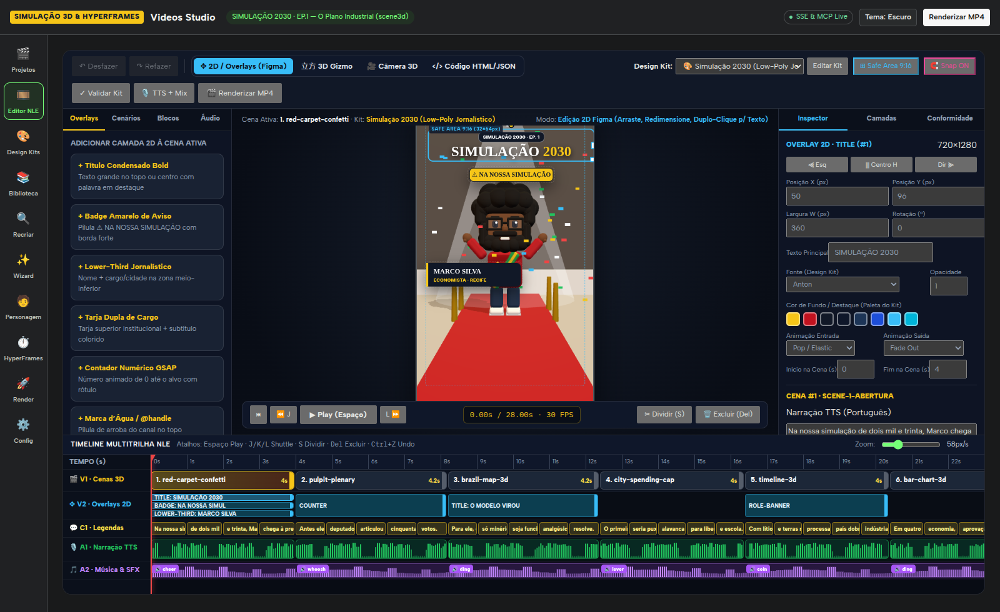
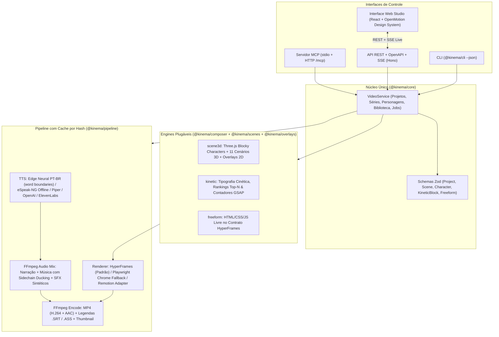

# Kinema

Estúdio open source para criar vídeos curtos verticais (Reels/Shorts/TikTok) com IA — personagens 3D procedurais, tipografia cinética e composições livres, renderizados localmente e de graça.

Kinema é da mesma família do **Ethos Reader**: nasceu para experimentar formatos narrativos com agentes de IA de ponta a ponta, sem depender de serviço pago de renderização.



Um frame renderizado do engine `scene3d` (estilo "Simulação 2030"): `docs/screenshots/07-rendered-mp4-frame-simulacao-2030.png`.

---

## Recursos

- **3 engines plugáveis**: `scene3d` (personagens 3D *blocky/chibi* procedurais + 11 cenários low-poly + câmeras + overlays jornalísticos), `kinetic` (tipografia cinética, rankings Top-N e contadores) e `freeform` (HTML/CSS/JS livre no contrato determinístico do HyperFrames).
- **Editor NLE multitrilha**: 6 trilhas sincronizadas (cenas 3D, overlays 2D, legendas, narração TTS com waveform, música e SFX), trim, split, zoom, scrubbing e atalhos de teclado.
- **Edição visual 2D/3D estilo Figma**: arraste/redimensione/rotacione overlays com snapping magnético às safe areas 9:16, edição de texto inline, Gizmo 3D (`TransformControls` XYZ) e órbita de câmera com keyframes.
- **Design Kits**: identidades visuais multi-engine com paleta semântica, tipografia permitida, safe areas, ritmo e regras — validadas automaticamente em cada projeto.
- **Biblioteca local com 3.200+ itens**: prompts virais, 99 estilos cinematográficos, 244 efeitos PixelFX, ~450 blocos HyperFrames e técnicas de recriação de vídeo.
- **Três formas de controle**: Servidor MCP (stdio + Streamable HTTP), CLI com `--json` e API REST/OpenAPI com SSE ao vivo.
- **TTS gratuito**: Microsoft Edge Neural PT-BR com timestamps palavra a palavra, com fallback offline via eSpeak-NG (Piper, OpenAI e ElevenLabs são opcionais).
- **Render 100% local**: HTML → MP4 (H.264/AAC) com FFmpeg, gerando também `.srt`, `.ass` e thumbnail.

---

## Pré-requisitos

- **Node.js >= 22** (testado em Node 24)
- **ffmpeg** e **ffprobe** no `PATH`
- **Google Chrome** ou **Chromium** (renderização headless)
- **git** (para sincronizar a biblioteca de referências)

Opcionais:

- `espeak-ng` — TTS offline de fallback
- `piper` — vozes neurais locais alternativas
- `whisper` — transcrição de áudio para legendas
- **ComfyUI** — geração de imagens local (`generate_image`)

Instalação das dependências do sistema:

```bash
# Fedora
sudo dnf install ffmpeg espeak-ng

# Ubuntu / Debian
sudo apt install ffmpeg espeak-ng

# macOS (Homebrew)
brew install ffmpeg espeak
```

O Chrome é detectado automaticamente; se estiver em outro caminho, defina `CHROME_PATH` no `.env`.

---

## Instalação

```bash
git clone https://github.com/<seu-usuario>/kinema.git
cd kinema
npm install
cp .env.example .env
```

Todos os pacotes são workspaces npm (`@kinema/core`, `@kinema/pipeline`, `@kinema/composer`, `@kinema/scenes`, `@kinema/overlays`, `@kinema/cli`, `@kinema/mcp`, `@kinema/server`, `@kinema/web`).

### Variáveis do `.env`

| Variável | Para que serve |
| --- | --- |
| `PORT` / `HOST` | Endereço do servidor HTTP (padrão `3456` em `127.0.0.1`). |
| `TTS_PROVIDER` | Voz padrão: `edge` (grátis, recomendado), `espeak`, `piper`, `elevenlabs` ou `openai`. |
| `TTS_DEFAULT_VOICE` | Voz neural usada quando a cena não define uma (padrão `pt-BR-AntonioNeural`). |
| `LLM_PROVIDER` | `manual` (roteiro escrito por você ou pelo agente), `gemini` ou `openai-compatible`. |
| `GEMINI_API_KEY` / `GEMINI_MODEL` | Chave e modelo do Gemini quando `LLM_PROVIDER=gemini`. |
| `OPENAI_API_KEY` / `OPENAI_BASE_URL` / `OPENAI_MODEL` | Qualquer endpoint compatível com a API da OpenAI (inclui servidores locais como Ollama/LM Studio). |
| `ELEVENLABS_API_KEY` / `ELEVENLABS_VOICE_ID` | TTS pago opcional. |
| `PIPER_BIN` / `PIPER_MODEL_PATH` | Binário e modelo do Piper para TTS local. |
| `IMAGE_PROVIDER` / `COMFYUI_URL` | `none` ou `comfyui`, com a URL do servidor local. |
| `RENDERER` | `hyperframes` (padrão e recomendado), `playwright` (fallback) ou `remotion` (adapter). |
| `CHROME_PATH` / `HYPERFRAMES_ROOT` | Caminho do Chrome e raiz da instalação do HyperFrames. |
| `MUSIC_DIR` / `SFX_DIR` | Pastas de trilhas e efeitos sonoros usadas na mixagem. |
| `KINEMA_DATA_DIR` | Diretório de dados (personagens, séries, jobs, projetos). Padrão `./data`. O nome antigo `VIDEOS_DATA_DIR` continua aceito. |

Nada é obrigatório para começar: sem chave de LLM e sem chave paga de TTS, o Kinema gera o vídeo completo com o agente externo + Edge TTS.

---

## Rodando

```bash
# Compila o frontend e sobe o servidor completo (UI + REST + SSE + MCP HTTP)
npm run build:web
npm run server
```

Abra **http://127.0.0.1:3456**.

`npm run dev` é um alias de `npm run server` (roda direto do TypeScript com `tsx`, útil durante o desenvolvimento da API); o frontend precisa de `npm run build:web` ou do Vite abaixo.

Durante o desenvolvimento da interface, use o Vite com proxy para a API:

```bash
npm run server     # terminal 1 — API na porta 3456
npm run dev:web    # terminal 2 — UI em http://127.0.0.1:5173
```

### Sincronizar a biblioteca local (3.200+ itens)

```bash
npm run library:sync
```

Clona com `--depth 1` os repositórios de referência em `library/vendor/` (ignorado pelo Git) e indexa os ~450 blocos locais do HyperFrames em `library/index.json`.

### Gerar os exemplos de ponta a ponta (MP4 + SRT + ASS)

```bash
npm run gen -- --example simulacao-demo   # flagship scene3d
npm run gen -- --example kinetic-top5     # tipografia cinética
npm run gen -- --example freeform-demo    # HTML/CSS/GSAP livre
```

Saída em `renders/<exemplo>.mp4` (+ `.srt`, `.ass`, `-thumb.png`).

---

## Como usar

1. **Crie o vídeo pelo Wizard.** Clique em **+ Novo Vídeo (Wizard)** no Dashboard (ou na trilha de navegação **Wizard**). Escolha o engine (`scene3d`, `kinetic` ou `freeform`), o estilo da Biblioteca, tema, duração (30/60/90/150s), tom, número de cenas, voz, estilo de legenda, personagem 3D e trilha. O botão de geração monta o projeto já roteirizado.
2. **Abra o Editor NLE.** Na navegação lateral, **Editor NLE**. O canvas central 9:16 mostra a composição; a timeline embaixo tem as trilhas de cenas, overlays, legendas, narração e música.
   - Reprodução: `Espaço` ou `K` (play/pause); `J` e `L` para shuttle ré/passa.
   - Edição: `S` divide o clipe no playhead, `Delete` remove a seleção, setas fazem *nudge* fino do elemento selecionado, `Ctrl+Z` desfaz e `Ctrl+Shift+Z` refaz.
3. **Alterne os modos do canvas.**
   - **2D / Overlays (Figma)** — arraste, redimensione, rotacione e dê duplo-clique para editar o texto do overlay, com snapping às bordas, centros e safe areas.
   - **3D Gizmo** — clique no personagem ou objeto e use os eixos XYZ (Mover / Rotacionar / Escalar).
   - **Câmera 3D** — orbite e aproxime com o mouse e clique em **Salvar Keyframe de Câmera** para gravar o enquadramento na cena.
4. **Aplique um Design Kit.** Em **Design Kits** na navegação, edite ou crie um kit (paleta, tipografia, safe areas, ritmo, regras e moodboard) e use **Aplicar** para trocar a identidade visual de todas as cenas de uma vez. No editor, o botão **Gerenciar Design Kits** abre o mesmo painel.
5. **Valide e ouça.** Rode a síntese de áudio quando o roteiro mudar — o TTS é gerado com timestamps palavra a palavra e mixado com ducking sidechain.
6. **Renderize e baixe.** Em **Render**, escolha resolução (`720x1280` ou `1080x1920`), FPS, CRF e renderer, clique em **Iniciar Renderização MP4 + SRT/ASS** e acompanhe o progresso por SSE. No fim, use **⬇ Baixar MP4**, **⬇ Baixar Legendas .SRT** e **⬇ Baixar Legendas .ASS**.

---

## Conectando uma IA (MCP)

O Kinema foi desenhado para que um agente externo (Claude Code, Cursor, Gemini CLI, VS Code etc.) crie o episódio completo sem exigir chave de LLM configurada no app. Toda alteração feita pelo agente aparece na Interface Web ao vivo via SSE.

### 1. Claude Code CLI

```bash
claude mcp add kinema -- npm --prefix /caminho/para/kinema run mcp
```

### 2. Arquivo `.mcp.json` (Claude Desktop / Cursor / VS Code)

```json
{
  "mcpServers": {
    "kinema": {
      "command": "node",
      "args": ["--import", "tsx", "/caminho/para/kinema/apps/mcp/src/index.ts"],
      "cwd": "/caminho/para/kinema"
    }
  }
}
```

### 3. Gemini CLI (`~/.gemini/settings.json`)

```json
{
  "mcpServers": {
    "kinema": {
      "command": "node",
      "args": ["--import", "tsx", "/caminho/para/kinema/apps/mcp/src/index.ts"]
    }
  }
}
```

### 4. MCP Streamable HTTP

Com `npm run server` ativo, o endpoint MCP responde em **`http://127.0.0.1:3456/mcp`** — útil para clientes web e para compartilhar a mesma sessão com a UI.

### Tools MCP disponíveis (34)

- **Engines & Templates**: `list_engines`, `get_engine_schema`, `list_templates`
- **Design Kits**: `list_design_kits`, `get_design_kit`, `create_design_kit`, `update_design_kit`, `apply_design_kit`
- **Biblioteca & engenharia reversa**: `search_library`, `get_library_item`, `breakdown_reference_video`
- **Personagens & vozes**: `list_characters`, `create_character`, `update_character`, `list_voices`
- **Séries & projetos**: `list_series`, `create_series`, `create_project`, `get_project`, `validate_project` (inclui checagem de paleta, fontes e safe areas do Design Kit)
- **Roteiro, cenas e overrides**: `set_script`, `set_composition`, `apply_style`, `add_effect`, `add_scene`, `update_scene` (aceita `overlays` 2D com `x/y/width/height/rotation`, `objectOverrides` 3D e `cameraOverride`), `remove_scene`, `reorder_scenes`
- **Áudio, imagem, preview e render**: `synthesize_audio`, `generate_image`, `render_preview_frames` (retorna PNGs como imagens MCP para inspeção visual do agente), `render_video`, `get_job_status`, `get_output`

### Resources & prompts MCP

- **Resources**: `kinema://docs/scene-schema`, `kinema://docs/style-guide`, `kinema://templates/{id}`
- **Prompts**: `create_episode` (fluxo Simulação 3D) e `create_video` (fluxo genérico multi-engine)

---

## CLI

Todos os comandos aceitam `--json` para uso em scripts:

```bash
npm run cli -- list-engines --json
npm run cli -- list-templates --json
npm run cli -- search-library --query "chart" --type block --json
npm run cli -- validate-project --projectId simulacao-demo --json
npm run cli -- render-preview-frames --projectId simulacao-demo --json
npm run cli -- breakdown-reference-video --video /caminho/referencia.mp4 --json
```

Rode `npm run cli` sem argumentos para ver a lista completa de comandos e flags.

---

## Arquitetura

Toda a lógica de negócio e a persistência vivem em uma **camada de serviço única** (`VideoService` em `packages/core`). A Interface Web, o Servidor MCP (stdio e Streamable HTTP), a CLI e a API REST chamam exclusivamente essa camada, com sincronização ao vivo via Server-Sent Events (SSE).



### Estrutura do monorepo (npm workspaces + TypeScript)

| Pacote / App | Descrição |
| --- | --- |
| `packages/core` | Schemas Zod (`Series`, `Project`, `Scene`, `Character`, `VoiceConfig`, `CaptionStyle`, `RenderSettings`, `KineticBlock`, `FreeformComposition`, `LibraryItem`, `ReferenceBreakdown`) e a camada única `VideoService`. |
| `packages/scenes` | Gerador procedural Three.js de personagens *blocky/chibi* (10 poses), 11 templates de cenário 3D e 6 presets de câmera. |
| `packages/overlays` | Overlays 2D (`title`, `badge`, `lower-third`, `role-banner`, `counter`, `watermark`, `progress-bar`, `effect`), legendas word-by-word (`highlight-yellow`, `karaoke`, `pop`, `box`), fontes locais `@fontsource` (Anton, Bebas Neue, Inter) e geradores `.srt`/`.ass`. |
| `packages/composer` | Abstração `VideoEngine` (`scene3d`, `kinetic`, `freeform`) que transforma projeto + áudio + timestamps em uma composição HTML determinística no contrato do HyperFrames (`window.__timelines["main"]` e `window.__seek(t)`). |
| `packages/pipeline` | Estágios com cache por hash SHA-256 (`tts`, `audio-mix`, `compose`, `render`, `encode`), sincronizador da Biblioteca (`library:sync`) e analisador de vídeo de referência (Rea-Video + `ffmpeg` scene detection). |
| `apps/server` | Servidor Hono com API REST, OpenAPI 3.1 (`/api/openapi.json`), fila de jobs com progresso via SSE (`/api/events`), arquivos estáticos e MCP Streamable HTTP em `/mcp`. |
| `apps/mcp` | Servidor MCP via `stdio` (34 tools, 3 resources e 2 prompts). |
| `apps/cli` | CLI completa com `--json`, gerador de exemplos (`npm run gen`) e sincronizador da biblioteca (`npm run library:sync`). |
| `apps/web` | Interface Web Studio construída com os tokens, fontes, ícones e padrões visuais do OpenMotion Design System. |

### Telas da Interface Web (10)

1. **Projetos** — dashboard de projetos e séries com preview 9:16, status e download de MP4/SRT.
2. **Editor NLE** — canvas visual 2D/3D + timeline multitrilha, camadas e inspector de propriedades.
3. **Design Kits** — identidades visuais multi-engine (`Simulação 2030`, `Editorial Minimal` e kits próprios), com extração de paleta via FFmpeg/Canvas, import/export JSON e preview ao vivo nos 3 engines.
4. **Biblioteca** — grid com busca instantânea e filtros (`prompt`, `style`, `effect`, `block`, `technique`) e o botão **Usar este prompt/estilo** que abre o Wizard preenchido.
5. **Recriar** — upload ou caminho de um MP4 de referência: detecção de cortes via FFmpeg, extração de frames e ficha Rea-Video.
6. **Wizard** — seleção de formato, estilo, tema, duração, tom, nº de cenas, voz, legendas, personagem e série.
7. **Personagem** — preview 3D orbitável 360°, 10 poses procedurais, cores de pele/cabelo/barba/óculos/roupas, escala chibi e acessórios (`sash`, `tie`, `suit`, `hat`, `microphone`, `badge`).
8. **HyperFrames** — scrubbing sincronizado com o áudio master e captura de snapshots PNG.
9. **Render** — resolução, FPS, CRF, workers, renderer, progresso SSE por estágio com logs ao vivo e download MP4/SRT/ASS.
10. **Config** — edição das chaves do `.env`, teste de vozes e status das 13 integrações.

### Engines

- **`scene3d`** (flagship) — recria o estilo visual da série **"SIMULAÇÃO 2030"**: personagens 3D procedurais *blocky/chibi* consistentes (zero custo de geração por frame), 11 cenários low-poly parametrizáveis (`red-carpet-confetti`, `pulpit-plenary`, `brazil-map-3d`, `city-spending-cap`, `timeline-3d`, `bar-chart-3d`, `street-protest`, `classroom-office`, `news-desk`, `courtroom`, `spotlight-close`), movimentos de câmera (`dolly-in`, `orbit`, `pan`, `close-face`, `shake`, `static`), overlays jornalísticos e legendas centrais palavra a palavra com destaque amarelo (`#f5c518`).
- **`kinetic`** — tipografia cinética, rankings Top-N, estatísticas e citações animadas.
- **`freeform`** — composição HTML/CSS/JS livre no contrato determinístico do HyperFrames.

---

## Criando um novo engine

Para adicionar um formato (ex.: `quiz`, `podcast-avatar`, `code-walkthrough`):

1. Adicione o identificador em `VideoEngineIdSchema` (`packages/core/src/schemas.ts`) e descreva-o em `VIDEO_ENGINES` (`packages/core/src/catalog.ts`).
2. Implemente a interface `VideoEngine` em `packages/composer/src/index.ts`:

   ```ts
   export class MeuNovoVideoEngine implements VideoEngine {
     public readonly id = 'meu-engine' as const;
     public async compose(project, characters, outputDir, options): Promise<ComposedArtifact> {
       prepareCompositionAssets(outputDir, options?.workspaceRoot);
       // Gere index.html com <div id="root" data-composition-id="main" ...>
       // Registre window.__timelines["main"] = gsap.timeline({ paused: true })
       // Exponha window.__seek = (t) => ...
       return { engine: this.id, compositionDir: outputDir, indexHtmlPath, srtPath, assPath, totalDuration, allWordTimestamps };
     }
   }
   ```

3. Registre a instância no mapa `ENGINE_REGISTRY` (`packages/composer/src/index.ts`). TTS, mixagem FFmpeg, preview de frames, render, MCP, CLI e UI passam a suportá-lo automaticamente.

---

## Integrações (13 ferramentas do ecossistema)

Todas são opcionais, desligadas por padrão quando exigem servidor próprio e detectadas automaticamente em **Config → Integrações**:

1. **HyperFrames** (`heygen-com/hyperframes`) — renderizador HTML → MP4 determinístico e ~450 blocos locais.
2. **Three.js** (`mrdoob/three.js`) — motor 3D WebGL para personagens blocky e cenários procedurais.
3. **GSAP** (`greensock/GSAP`) — timeline determinística pausada e seekável.
4. **FFmpeg** — mixagem com sidechain ducking, SFX sintéticos, scene detection e encode H.264/AAC.
5. **Rea-Video** (`JuneYaooo/rea-video`) — metodologia de breakdown e recriação de vídeos de referência.
6. **Awesome Opus 5.5 Videos** (`yihui-dev/awesome-opus5-5-videos`) — prompts de vídeos virais indexados na Biblioteca.
7. **Lemo-Opuscar** (`lemomo-ai/lemo-opuscar`) — 99 estilos cinematográficos clonados apenas localmente.
8. **PixelFX** (`patch-gg/pixelfx`) — 244 efeitos pixel art e overlays visuais.
9. **Remotion Skills** (`remotion-dev/skills`) — técnicas de animação programática para consulta do agente.
10. **ComfyUI** (`Comfy-Org/ComfyUI`) — `ImageProvider` HTTP local opcional (`IMAGE_PROVIDER=comfyui`, tool MCP `generate_image`).
11. **Remotion** (`remotion-dev/remotion`) — adapter `Renderer` alternativo opcional (`RENDERER=remotion`).
12. **Blender MCP** (`ahujasid/mcp-for-blender`) — ponto de extensão `ExternalScene3DProvider` para exportar cenas `.glb` do Blender.
13. **EffectCraft** (`storytold/effectcraft`) — ponto de extensão `VfxPostProcessor` em Rust para shaders e pós-processamento.

---

## Ideias futuras

- **Blender MCP para cenas 3D de alta fidelidade** — conectar a interface `ExternalScene3DProvider` (`packages/pipeline/src/providers.ts`) a uma instância local do Blender via MCP para modelar cenários complexos com iluminação Cycles/EEVEE e carregar os `.glb` via `GLTFLoader` dentro das composições HyperFrames.
- **ComfyUI para texturas e skyboxes 3D** — expandir o `generateSceneImage` para gerar mapas equiretangulares 360° e texturas PBR aplicadas automaticamente aos prédios e pisos dos templates `scene3d`.
- **Remotion como renderer React nativo** — compor cenas com componentes React em vez de templates HTML+GSAP, expandindo o `RemotionRenderer` (`packages/pipeline/src/renderer.ts`) com `@remotion/bundler` e `@remotion/renderer`.
- **EffectCraft Rust VFX** — integrar o binário `effectcraft` ao estágio `encode` para transições shader aceleradas por GPU entre cenas.

---

## Testes

```bash
npm test            # vitest: core, legendas, editor/design kits e integração MCP via stdio
npm run typecheck   # tsc --noEmit em todo o monorepo
npm run build:web   # build de produção da interface
```

---

## Licença e créditos

Não há arquivo `LICENSE` na raiz: **licença a definir**.

Os componentes adaptados de projetos open source (OpenMotion/OpenDesign Design System, HyperFrames, Three.js, Remix Icon e os repositórios indexados pela Biblioteca) estão documentados, com origem, versão de licença e declaração de modificação, em [`THIRD_PARTY_NOTICES.md`](THIRD_PARTY_NOTICES.md).
